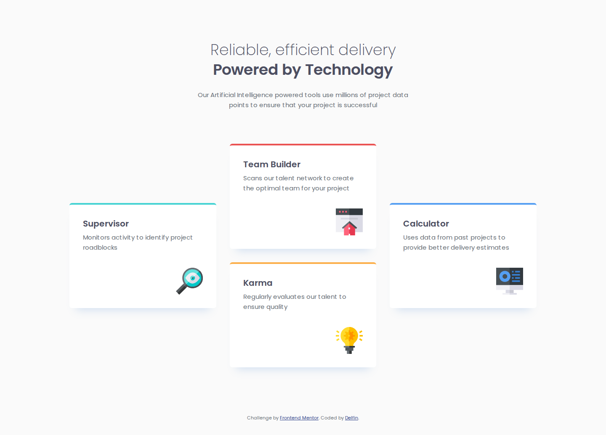
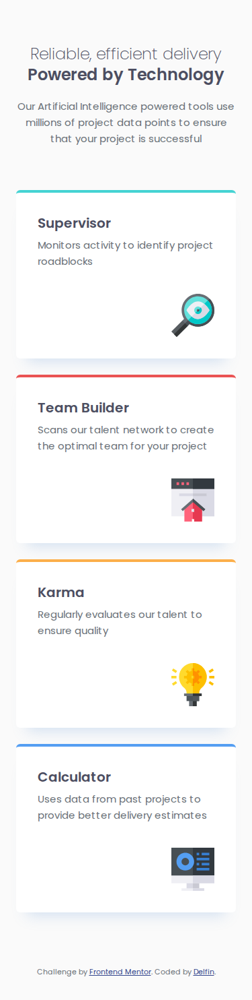

# Frontend Mentor - Four card feature section solution

A solution to the [Four card feature section challenge on Frontend Mentor](https://www.frontendmentor.io/challenges/four-card-feature-section-weK1eFYK).

## Overview

### The challenge

Users should be able to view the optimal layout for the section depending on their device's screen size.

### Screenshots

| Desktop (1440px) | Mobile (375px) |
| --- | --- |
|  |  |

### Links

- Solution URL: https://github.com/delfinjfb/four-card-feature-section
- Live Site URL: https://four-card-feature-section-gamma-seven.vercel.app

## My process

### Built with

- Semantic HTML5 (`main`, `header`, a list of cards, one `h1`)
- CSS custom properties (colours and font from `style-guide.md`)
- CSS Grid, mobile-first, one breakpoint at 62rem (992px)
- Poppins (200, 400, 600) from Google Fonts

### What I learned

The desktop layout is not a simple 4-column row: the middle column holds two stacked cards while the outer cards sit vertically centred. Instead of nesting wrappers, I kept the four cards as a flat list in reading order (Supervisor, Team Builder, Karma, Calculator) and placed them with explicit grid lines on desktop:

```css
.card--supervisor,
.card--calculator { grid-row: 1 / 3; align-self: center; }
.card--team-builder { grid-column: 2; grid-row: 1; }
.card--karma { grid-column: 2; grid-row: 2; }
```

The DOM order stays the same as the mobile stack, so the reading and tab order are correct on every screen.

### Quality checks

- No horizontal scroll at 320, 375, 599, 600, 991, 992 and 1440px (`scrollWidth` equals the viewport width).
- Text contrast measured against WCAG AA (4.5:1): grey 400 on white 5.03:1, on the page background 4.81:1; grey 500 7.78:1; footer link 8.27:1.
- Decorative icons use `alt=""` and have `width`/`height` to avoid layout shift.

### Continued development

- Add the tablet layout from the Figma file (only mobile and desktop designs were available).
- Self-host the font to remove the Google Fonts request.

### AI collaboration

I used Claude Code to build the first version from the starter files and the design images, then checked the result myself with screenshots next to the designs. It was fast for the layout; the contrast figures and the responsive widths were verified by script, not assumed.

## Author

- GitHub - [@delfinjfb](https://github.com/delfinjfb)
